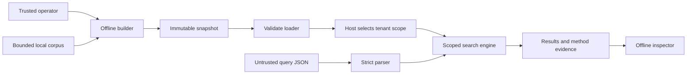
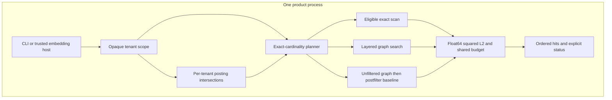
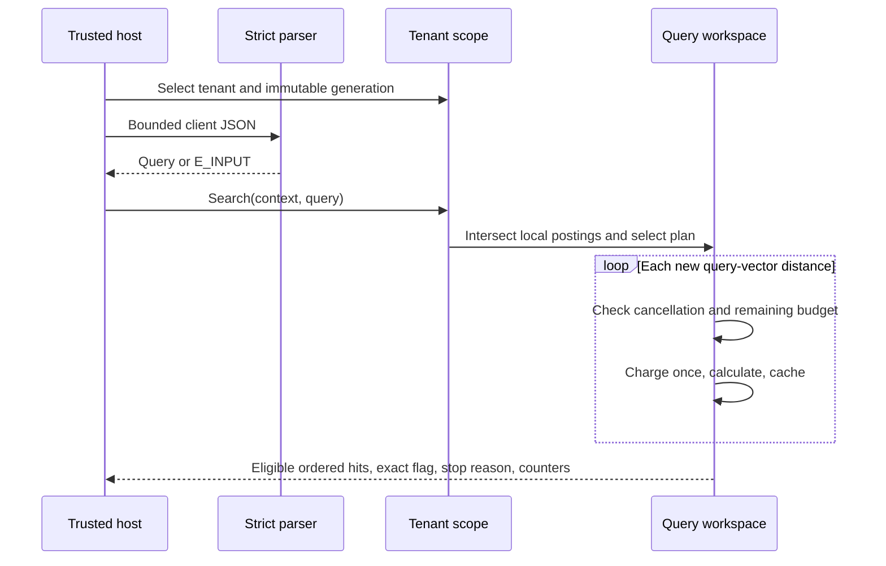
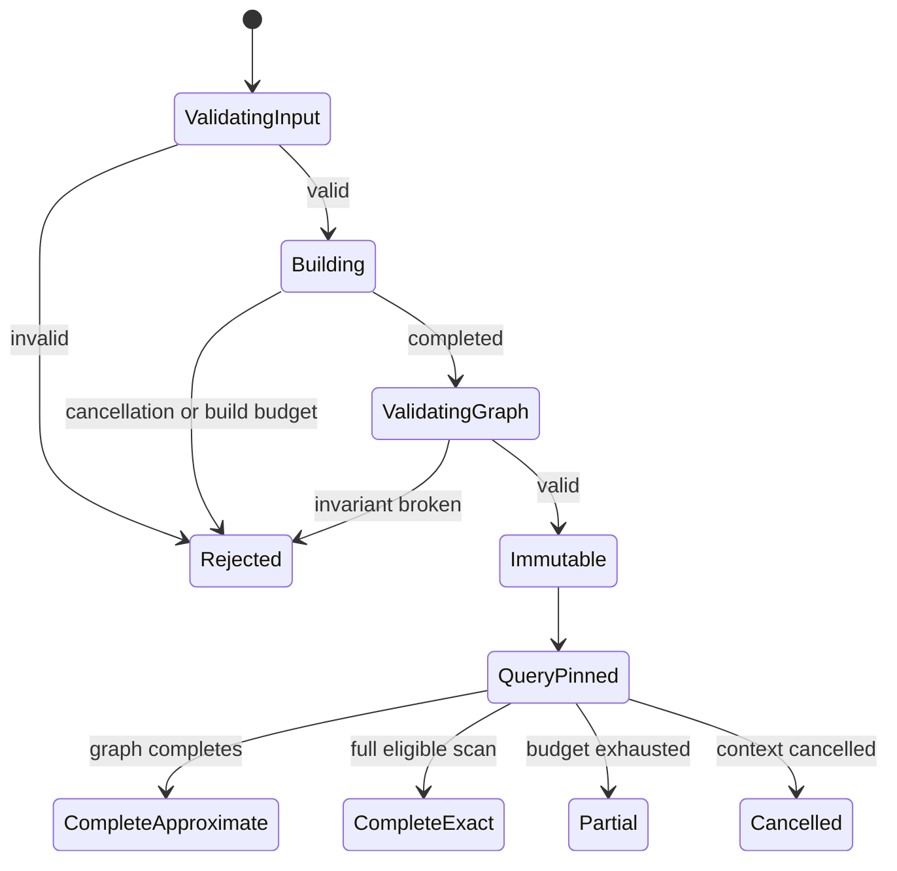
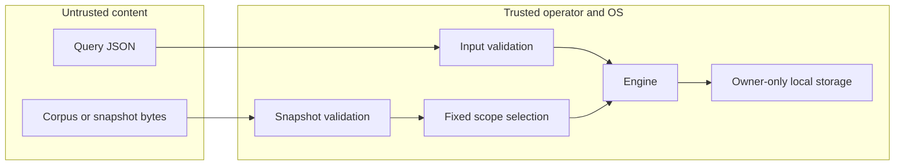
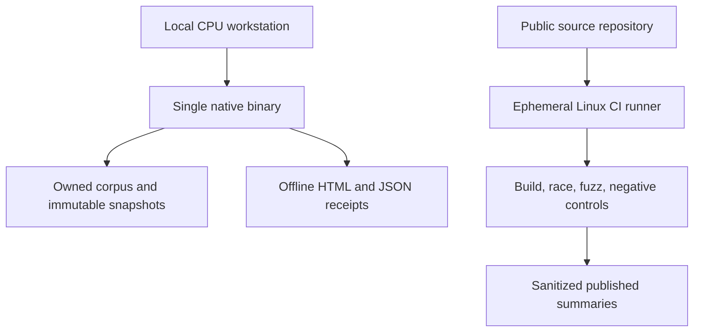
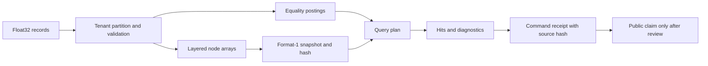

# Technical architecture
Version 1.0 | Proposed complete core; implementation status is separate

## Context and boundary
FacetQuarry is a library plus CLI, not a network service. Trusted host code loads a validated immutable collection and selects a tenant scope. An untrusted query can supply only a vector, equality filter and bounded search controls. Scope selection and input artifact paths are outside the client schema.

## Modules, ownership and process model
`internal/engine` owns vectors, nodes, posting lists, numerical distance, heaps, HNSW construction, plans and query counters. Public Go access is through Build/Load -> Collection.Scope -> Scope.Search; internal records, graph arrays and postings are not exposed. `internal/strictjson` owns one-value strict decoding. `cmd/facetquarry` owns operator flags and machine output. Python tools own independent exhaustive reference, fixtures, actual subprocess demonstrations and command receipts. They cannot provide answers on behalf of the Go engine.

A single builder is mutable until validation succeeds; afterward its generation is read-only. Each search owns candidate/result heaps, visited/cache state and budget/context. No goroutine per node; optional application concurrency is bounded externally. The core introduces no queue, remote RPC, service registry or background worker.

## Graph and numerical algorithm
This design implements established HNSW ideas, not a new ANN algorithm. Source references: HNSW paper algorithms 1-5; hnswlib as comparator documentation, not copied product code. [S-HNSW, S-HNSWLIB in SOURCE_LEDGER]

Sort tenant-local IDs, shuffle with the configured seeded generator, and insert sequentially. Sample a capped geometric level using floor(-log(U)/log(M)), U strictly between zero and one. Greedy upper-layer routing finds a starting point; best-first search on each insertion layer uses a min-candidate heap and bounded max-result heap. Diversified pruning prefers a candidate not closer to an already retained neighbor than to the base node, then fills from the discarded pool when needed. New links are bidirectional when added; subsequent local pruning can make edges asymmetric. Never assert a permanently undirected graph. Degree caps and every referenced level are validated.

Query distance converts stored/query float32 coordinates to float64 before subtraction. Sum squared differences in coordinate order; no square root. Finite magnitude/dimension bounds make accumulated float64 overflow impossible within the contract. IDs resolve exact distance ties. The executable does not promise identical floating arithmetic across every CPU/compiler future version.

## Filtering and plans
Metadata is a map of string equality facets. A posting list contains node indices for one key/value in one tenant. Intersect smallest lists first; no list is shared across tenant graphs. The exact method evaluates every eligible vector unless its distance budget/context stops it.

The graph method navigates all vectors inside the already authorized tenant, including vectors failing the relevance filter. Its bottom-layer eligible result heap guides stopping; traversing ineligible bridges avoids artificially disconnecting the graph. It may still miss neighbors. This is not an arbitrary ACL traversal policy and is not labeled ACORN. The postfilter baseline first selects unfiltered approximate top-k, then removes nonmatching hits; it may return fewer than k even when enough matches exist. The auto plan chooses exact for <=256 eligible rows, graph otherwise. Every method reports the actual chosen plan; benchmark pure plans separately to avoid hiding exact work in approximate claims.

## Request sequence and budgets

Budgets count actual unique query-vector calculations; cached values are not recomputed/charged. They do not bound every CPU instruction, wall time or allocation. Max dataset/metadata/ef/input dimensions separately bound other work and memory. Cancellation checks occur at distance boundaries and bounded loops; pre-cancelled contexts are checked even for empty eligible sets. Build pruning distances also charge its separate total build budget. Exhausted builds never publish partial indexes.

## Snapshot and state ownership
A format-1 snapshot contains magic `FQIDX001` (8 bytes), little-endian uint64 payload length, SHA-256 payload digest (32 bytes), then canonical Go JSON containing version, build options, dimension, tenant records, entry points, levels and adjacency. Header is 48 bytes. Length must exactly match; cap 128 MiB. Validate record limits, dimensions, tenant and ID uniqueness, finite vectors, entry/level bounds, every edge, self/duplicate links and per-level degree. Rebuild postings from records after validation. A digest detects accidental changes; a malicious writer can recompute it, so structural checks remain mandatory and digest is not authenticity.

Write to a new same-directory temporary file, flush file, atomically publish to a destination that must not already exist (or use an explicit operator-managed generation path), and preserve any old artifact on failure. Prefer hard-link/no-clobber publication on supported local filesystems; directory synchronization is a Linux durability supplement. Unsupported filesystems need explicit limitations. Format changes use a new version, not silent migrations. No crash/power-loss certification is implied.

## Trust zones and deployment

## Data flow, compatibility and operations

CLI commands are versioned via output `schema_version=1`. Errors go to stderr as a bounded JSON envelope; stdout contains one result object or JSONL only for the explicit batch command. There are no retries for logical errors, no circuit breaker without a remote service, no secrets and no remote logging. Startup validates before opening scope. Shutdown needs no state flush for reads; SIGINT/SIGTERM cancels work. Temporary outputs are never treated as complete snapshots. Backup is copying a completed immutable file plus its checksum; restore is validation before use.

## Removal tests
| Component | Requirement | Simpler alternative | Decision / property lost on removal |
|---|---|---|---|
| Original HNSW | FR-003 | Exact scan only | Keep; removes algorithmic approximation experiment otherwise |
| Exact scan | FR-002 | Trust ANN answers | Keep; loses trustworthy eligible-set semantics and baseline |
| Posting intersections | FR-004 | Scan metadata every query | Keep; exposes exact cardinality and selective-plan cost; test against scan |
| Per-tenant graphs | SEC-001 | Global graph plus final filtering | Keep; removes clear traversal boundary otherwise |
| Opaque scope | FR-007 | Tenant in client JSON | Keep; removes host-owned authority |
| Immutable snapshots | FR-006, REL-001 | Rebuild each request | Keep; loses reusable generation identity/read-only lifecycle |
| Offline HTML | FR-008 | JSON only | Keep thin; improves reviewer comprehension, never supplies search logic |
| Database/cluster/LLM | None | Local files and original engine | Remove; adds no necessary core property |
