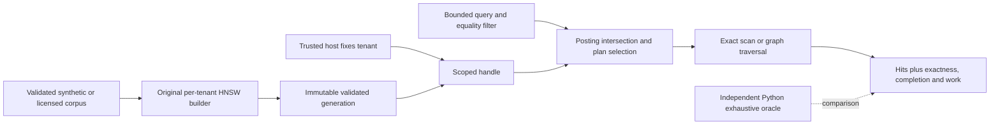

<div align="center">

# FacetQuarry
### Search the eligible set. Show the tradeoff.
**An original filtered vector-search engine and reproducible approximation experiment.**

[Run](#run-the-engine) | [Architecture](ARCHITECTURE.md) | [Contracts](ACCEPTANCE_SPEC.md) | [Evidence](VERIFICATION_REPORT.md) | [Limits](LIMITATIONS.md)

Go standard-library core | Offline-first | MIT | Experimental
</div>

---

Nearest neighbors are not necessarily the nearest **eligible** neighbors. FacetQuarry makes that distinction visible: an original hierarchical graph, exact filtered ground truth, a deliberately weak postfilter baseline, and a small disclosed planner all operate on the same vectors.

> **Development status:** The real engine and verification tooling are implemented. Local developmental checks have run, but full benchmark qualification, a supported-toolchain rerun, genuine independent review, actual browser review and owner walkthrough remain open. There is no production-use, availability, universal-recall or superiority claim. Read the source-bound [verification report](VERIFICATION_REPORT.md).

| Build the graph | Bound the request | Inspect the result |
|:--|:--|:--|
| Original HNSW layers, heaps, diversified neighbor pruning and deterministic construction. | Host-fixed tenant partitions, equality posting intersections, strict inputs and distance-work budgets. | Exactness, completeness, plan, work count, generation and filter-specific recall are separate facts. |

## Run the engine

Reference environment: Linux, Go **1.27.3**, Python 3.11+, Git, Make and a C compiler for race detection. Go 1.23 language compatibility is not a supported-release promise. The Python tooling has no package dependencies.

```sh
make bootstrap
make build
make demo
```

Open **`.local/demo/report.html`**. The offline report comes from actual CLI executions, not mock screenshots. No API key, model weights, cloud account, GPU, Docker or database is required.

```sh
./bin/facetquarry build --input examples/corpus.json --output .local/example.fq
./bin/facetquarry search --index .local/example.fq --tenant alpha --query examples/query.json
```

Snapshot publication is no-clobber: use a fresh output path for a new build. CLI flags are trusted operator controls; an untrusted query JSON cannot set a tenant or filesystem path.

## What the engine owns



The planner scans exactly when the eligible set has at most 256 records and otherwise selects graph search. Explicit graph and postfilter modes remain available for experiments. An empty eligible set is disclosed as exact without computing distances. Graph completion does not mean exactness. Exhausting a distance budget never produces a falsely exact result.

## Reproduce the checks

```sh
make ci                 # Build, formatting, vet, tests, race, mutations, demo, smoke.
make property           # 1,000 independently calculated exact-search cases.
make fuzz               # Two bounded 30-second campaigns; inspect actual receipts.
make security           # Public path/history checks and targeted secret patterns.
make security-online    # Requires a verified installed govulncheck; otherwise fails.
make benchmark          # Full frozen synthetic grid; not a cheap PR check.
make clean-verify       # Fresh committed local checkout, separate caches.
make release-verify     # Fails closed while locked evidence is missing.
```

A passing smoke cell means the experiment completed and its checked invariants held, **not** that recall was perfect. The full grid has 5,400 cells and is not claimed as executed in this handoff. [Evaluation](EVALUATION.md) explains the workload, denominator, reference target and measurement scope. Published receipts are trusted-host execution records, not independent cryptographic attestations.

## Deliberate boundaries

Tenant partitions are a host-enforced data-selection boundary. Within-tenant metadata is relevance filtering, **not arbitrary record authorization**. The process owner can inspect memory/files; no hostile-code sandbox, timing privacy, cryptographic snapshot authenticity or prompt-injection defence is claimed.

The core is immutable and local. It deliberately omits live updates, distributed execution, replication, vector quantization, GPU/SIMD kernels, model generation and a public network service. A corrupt snapshot is rejected; a valid digest is not proof of a trusted author.

| Understand | Reproduce | Challenge |
|:--|:--|:--|
| [Architecture](ARCHITECTURE.md) | [Demo guide](docs/demo/DEMO.md) | [Threat model](THREAT_MODEL.md) |
| [API and snapshots](API_SPEC.md) | [Tests and criteria](TEST_MATRIX.md) | [Limitations](LIMITATIONS.md) |
| [Design decisions](docs/DECISIONS.md) | [Claims and receipts](CLAIMS_EVIDENCE.md) | [Technical defence](docs/PORTFOLIO_DEFENCE_MAP.md) |
| [Operations](OPERATIONS.md) | [Verification status](VERIFICATION_REPORT.md) | [Contributing](CONTRIBUTING.md) |

Original code is [MIT licensed](LICENSE). Prior algorithms and optional comparison tools retain their own [notices](THIRD_PARTY_NOTICES.md). No upstream benchmark number is presented as a FacetQuarry result.
